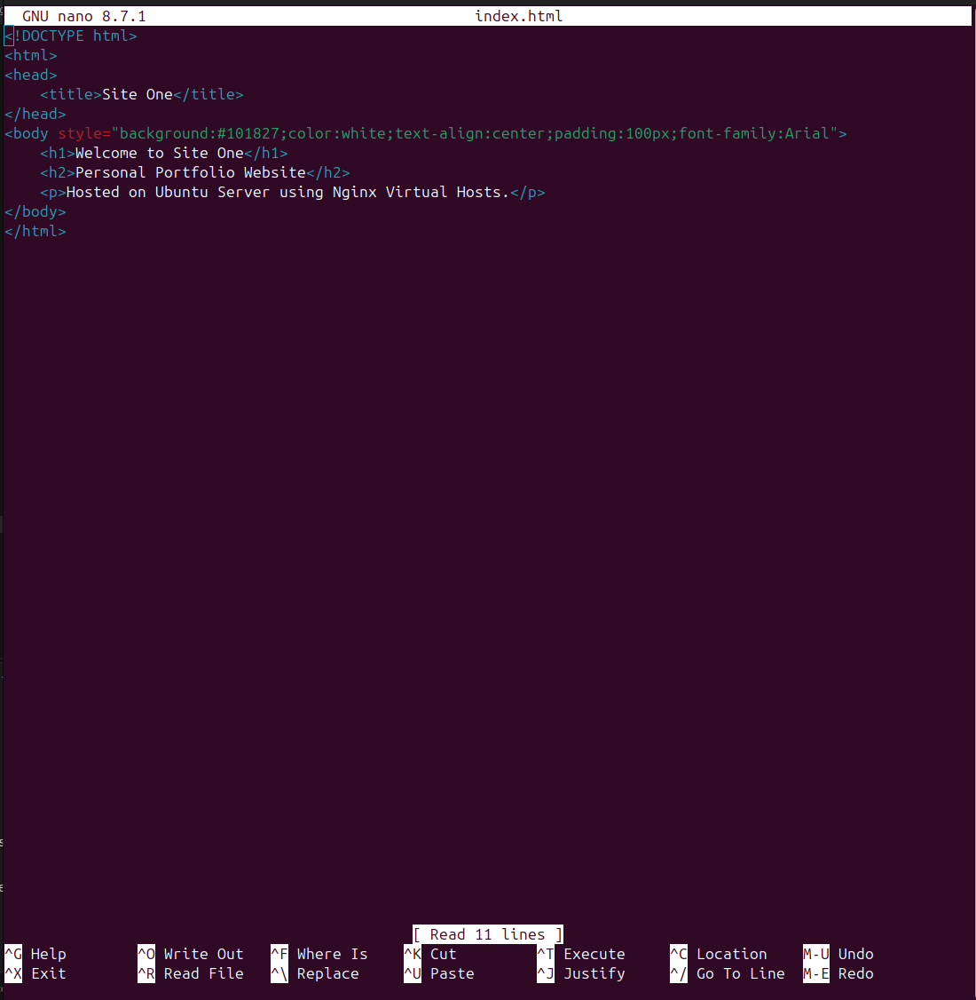
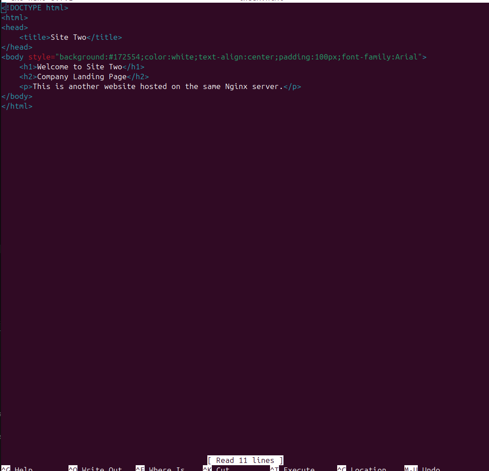
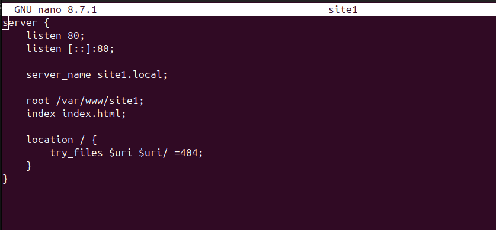
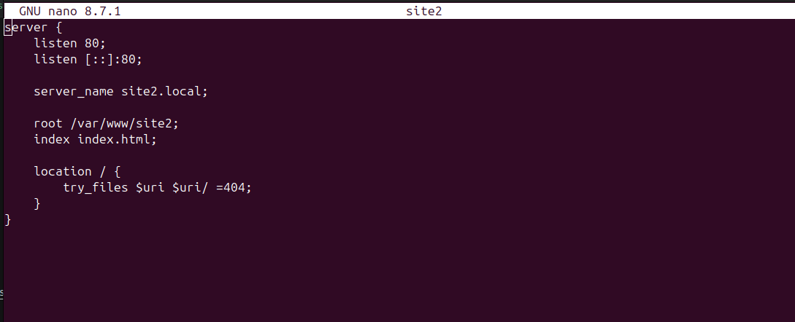
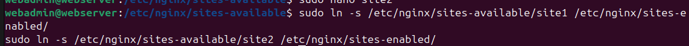
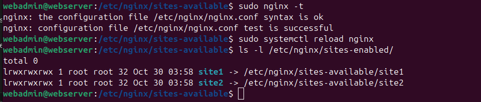
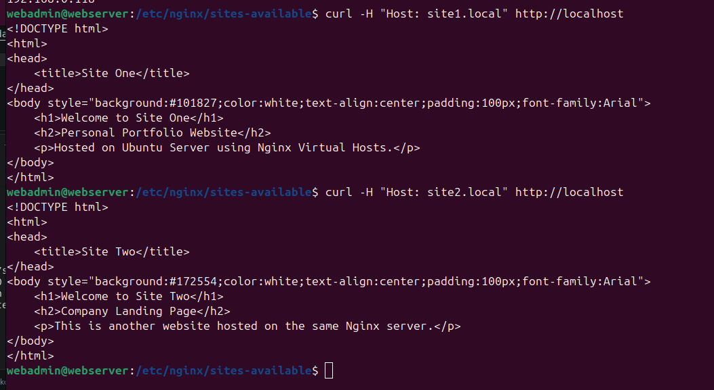

/var/www/
│
├── mywebsite/
│   └── index.html
│
├── site1/
│   └── index.html
│
└── site2/
    └── index.html

/etc/nginx/
│
├── sites-available/
│   ├── default
│   ├── site1
│   └── site2
│
└── sites-enabled/
    ├── site1 -> ../sites-available/site1
    └── site2 -> ../sites-available/site2

3. Create the bot folder for website

3. Create the first website

3. Create the second website

giving permission

. Configure the first virtual host

. Configure the second virtual host

7. Enable both virtual hosts
Create symbolic links:

Disable the default configuration so it doesn't interfere with our test:

Realoading and validation

curling both sites

