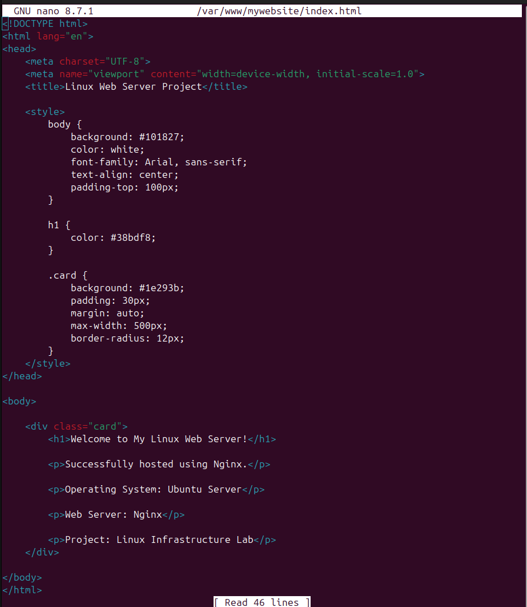
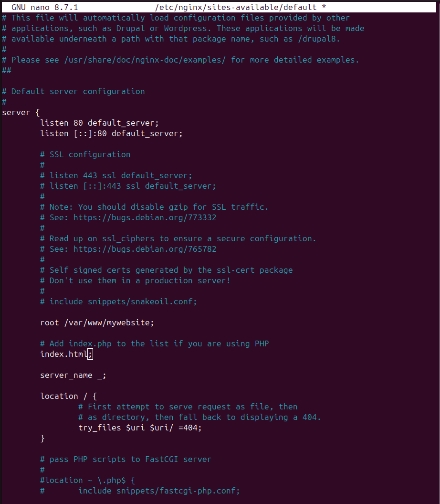
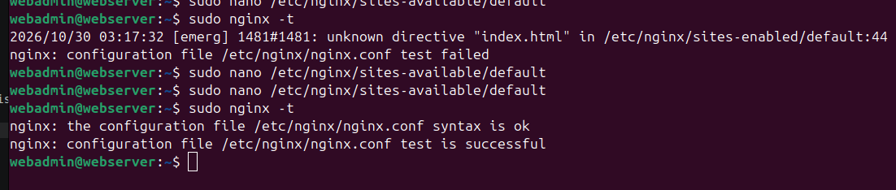
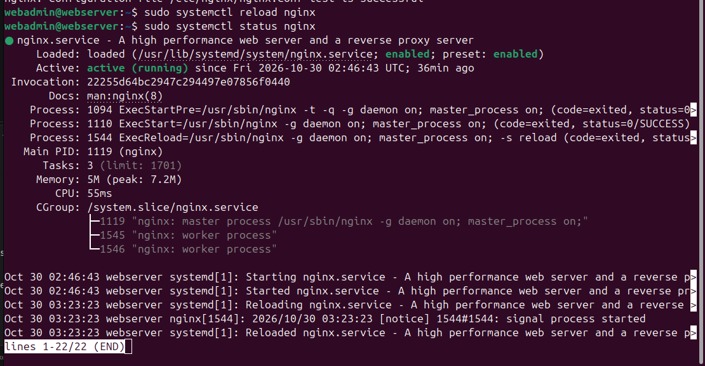

updated 

sudo apt update

Ngnix installagtion

status

Test web server

run URL in host browser

Architectural diagram

giving permission to folder of nginx 

adding html in ngnix 

Configure Nginx to serve your website

What did we configure? 
Directive	Purpose 
listen 80	Listen for HTTP requests 
root	Website directory 
index	Default homepage 
server_name	Matches incoming hostname 
location /	Handles website requests 
try_files	Checks whether requested files exist 

check the configuration file status

reloading the bash

